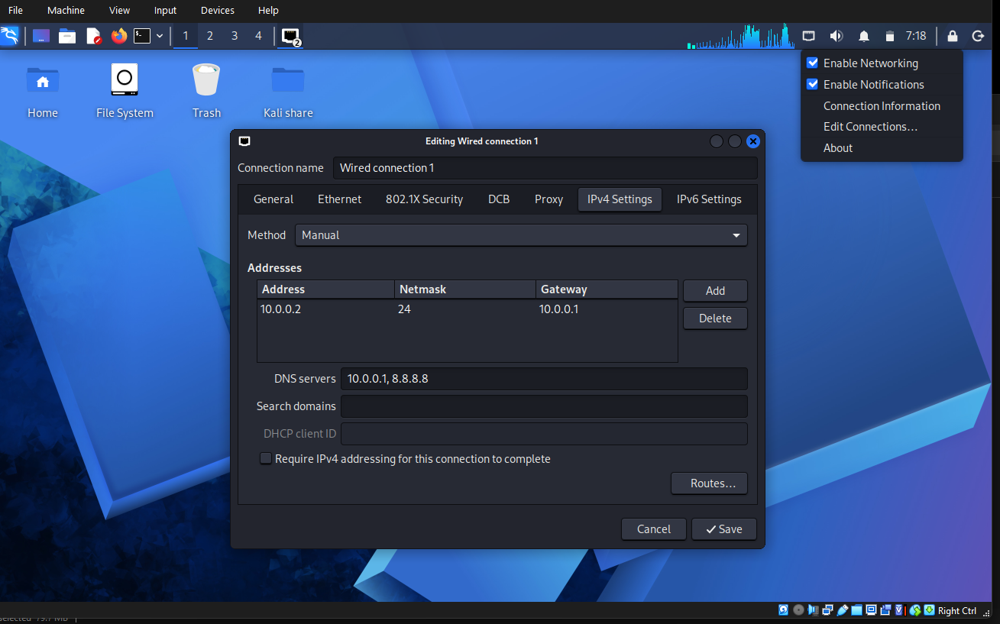

# Cybersecurity Lab Setup

## 💻 Project Description 
This project documents the setup of a virtual cybersecurity lab using Oracle VirtualBox and Kali Linux. The goal was to configure a NAT Network, import a Kali Linux virtual machine, and prepare the environment for cybersecurity and ethical hacking practice.

## 📌 Objectives
- Install and configure Oracle VirtualBox.
- Create a NAT Network using the `10.0.0.0/24` network range.
- Import and configure a Kali Linux virtual machine.
- Set up Kali Linux network settings.
- Prepare a virtual lab environment for future security exercises.

## ⚙️ Resources and tools
- Oracle VirtualBox 7.2
- Kali Linux
- 7-Zip
- NAT Networking
##  Lab Setup Procedure

### Step 1: Install and configure 7-Zip
7-Zip was installed to unpack the compressed Kali Linux virtual machine files before importing them into VirtualBox.

### Step 2: Install the VirtualBox
Oracle VirtualBox was installed to create and manage the virtual environment required for the cybersecurity lab.

### Step 3: Create a NAT network in VirtualBox
A NAT Network was configured in VirtualBox to provide network connectivity for the virtual machines and support communication within the lab.

### Step 4: Deploy Kali Linux
The Kali Linux virtual machine was downloaded from the official Kali Linux website and imported into Oracle VirtualBox.

### Step 5: Configure Kali Linux Network Connectivity
The network settings within Kali Linux were reviewed and configured to prepare the virtual machine for networking and security exercises.

### Step 6: Create a clean Virtual Machine Snapshot
After the initial setup was completed, a VirtualBox snapshot was saved to preserve the configured state of the virtual machine. This provides a recovery point for future lab activities.

## Learning Outcomes
Through this project, I gained practical experience with virtual machine setup, NAT networking, Linux lab configuration, and preparing a controlled environment for cybersecurity practice.

## Conclusion
This lab provides a foundation for further hands-on learning in networking, cybersecurity, and ethical hacking.

**Project Type:** Cybersecurity Lab Setup  
**Learning Program:** NetworkWalks Internship

